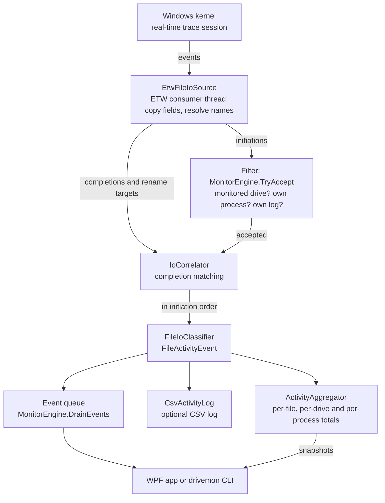

# Architecture

DriveMonitor is one engine, `MonitorEngine` in `src/DriveMonitor.Core`, with two front ends: the WPF app
(`src/DriveMonitor.App`) and the `drivemon` CLI (`src/DriveMonitor.Cli`). This document describes how the
engine turns the Windows kernel's file I/O trace into events and totals. Statements about TraceEvent 4.0.0
and the kernel trace come from reading TraceEvent's source and Microsoft's ETW documentation; the CI
self-test checks the most important of them on a real kernel.

## Components

| Type | File | Role |
| --- | --- | --- |
| `MonitorEngine` | `MonitorEngine.cs` | Owns the pipeline: lifecycle, filtering, publication, counters |
| `MonitorOptions` | `MonitorOptions.cs` | Session name, buffer size, completion wait, limits |
| `EtwFileIoSource` | `Tracing/EtwFileIoSource.cs` | The kernel trace session, its consumer thread and DriveMonitor's own name tables |
| `PendingIo` | `Tracing/PendingIo.cs` | The fields copied out of one kernel initiation event, plus its completion |
| `IoCorrelator` | `Tracing/IoCorrelator.cs` | Matches completions and rename targets to their operations |
| `FileIoClassifier` | `Tracing/FileIoClassifier.cs` | Turns a matched operation into a `FileActivityEvent` |
| `NtStatusText` | `Tracing/NtStatusText.cs` | Short descriptions of NTSTATUS codes ("not found", "access denied") |
| `ProcessNameCache` | `Tracing/ProcessNameCache.cs` | Process ID to image name |
| `VolumeMapper` | `Volumes/VolumeMapper.cs` | Kernel paths to DOS paths |
| `DriveCatalog`, `StorageQuery` | `Volumes/` | Drive letters with type, bus, model, size and file system |
| `DriveFilter` | `Filtering/DriveFilter.cs` | The monitored drive letters |
| `ActivityAggregator` | `Aggregation/ActivityAggregator.cs` | Totals per file, per drive and per process |
| `CsvActivityLog`, `Csv` | `Export/` | The continuous CSV log and CSV export |

Paths are relative to `src/DriveMonitor.Core`.

## Pipeline

1. **Kernel session.** `EtwFileIoSource` starts a real-time kernel session in system-logger mode with these
   kernel keywords:
   - `FileIOInit`: the initiation events (create, read, write, set information, delete, rename, cleanup,
     close, flush, folder enumeration);
   - `FileIO`: the `FileIo_OpEnd` completions, with the final NTSTATUS and the bytes transferred (only
     while `UseCompletionEvents` is on, the default);
   - `DiskFileIO`, plus `DiskIO`, which it requires: the events that bind a file name to a FileKey.

   TraceEvent adds the Process and Thread keywords itself. The kernel cannot filter file events by volume,
   so the session receives the file activity of the whole system.
2. **Copy.** The callbacks for initiation events copy the fields they need into a `PendingIo` (TraceEvent
   reuses its event objects), resolving the file name and the process name on the way. Initiations and
   completions are counted in `KernelEvents`.
3. **Filter.** For every initiation event, `MonitorEngine.TryAccept` converts a path that is still in
   kernel form, then rejects it when the path is not on a monitored drive (an empty path is counted as
   `UnnamedEvents`), when it comes from DriveMonitor's own process and `ExcludeOwnProcess` is set, or when
   it is the engine's own CSV log file. Completions and rename targets carry no file name of their own, so
   they go straight to matching.
4. **Completion matching.** `IoCorrelator` attaches completions and rename targets to their operations and
   releases the operations in the order they started (see [Completion matching](#completion-matching)).
5. **Classification.** `FileIoClassifier.Classify` turns each released operation into a
   `FileActivityEvent` (see [Classification](#classification)).
6. **Fan-out.** `MonitorEngine.Publish` records the event in `ActivityAggregator`, writes it to the CSV log
   if one is running, and then adds it to a `ConcurrentQueue`. Statistics and the log come before the
   queue, so an event dropped from a full queue still counts in the totals and in the log.
7. **Front ends.** The app drains the queue on a UI timer and takes snapshots of the statistics that
   changed; the CLI drains it and prints each event.

### Classification

| Kernel operation | Becomes | Details |
| --- | --- | --- |
| Read, Write | `Read`, `Write` | Bytes from the completion (never more than requested); the requested size when no completion was seen; 0 when it failed. `Paging` from `IRP_PAGING_IO` (0x2), `NonCached` from `IRP_NOCACHE` (0x1). |
| Create | `Create` or `Open` | From the completion: `FILE_CREATED` → Create "created", `FILE_OVERWRITTEN` → "overwritten", `FILE_SUPERSEDED` → "replaced", anything else → Open. Without a completion, inferred from the requested disposition ("new file requested", ...). `FILE_DIRECTORY_FILE` sets `Directory`; `FILE_DELETE_ON_CLOSE` sets `DeleteOnClose` unless the open failed. |
| Delete, or set information with class 13 or 64 | `Delete` | The requested state is in ExtraInfo; a request without the delete bit becomes `SetInfo` "delete cancelled". |
| Rename, or set information with class 10 or 65 | `Rename` | Target from the path event when Windows sent one ("→ new path", or "moved to the Recycle Bin"), otherwise "renamed or moved". |
| Set information with class 11 or 72 | `SetInfo` | "hard link created" or "hard link → target". |
| Set information with class 20 | `SetInfo` | "size → N bytes", `SizeChange`, `Bytes` = the new size. |
| Other set information | `SetInfo` | Allocation size, valid data length, "attributes or timestamps", "short name changed", or "information class N". Class 14 (file-pointer moves) produces no event. |
| Flush | `Flush` | |
| Folder enumeration | `List` | `Directory`; "pattern X" unless the pattern is `*`. |

An operation without a completion has status `Unknown`. With one, it is `Success` when the NTSTATUS is a
success code, or for a folder enumeration that ended with "no more files" or "no such file"; otherwise it is
`Failed` and its detail becomes the reason from `NtStatusText`. In `ActivityAggregator`, failed operations
are only counted, paging I/O goes into separate paging totals and is never attributed to a process, and
folders get a file row only when they are created, deleted or renamed.

## Threading model

| Thread | What runs there |
| --- | --- |
| ETW consumer (`DriveMonitor ETW consumer`, background, above-normal priority so kernel buffers do not overflow) | TraceEvent's `Process()` loop and every callback: copying fields, the name tables, the path mapper, `TryAccept`, and the correlator's `Begin`, `Complete` and `Annotate`, each followed by releasing the operations that are ready |
| Release timer (thread pool, every 250 ms) | Releases operations whose wait for a completion ran out |
| Flush timer (thread pool, every `FlushIntervalMs`, 500 ms by default) | `session.Flush()`, so Windows hands over buffered events sooner than the 1 s flush timer TraceEvent sets for the session |
| CSV log writer (thread pool task) | Drains a bounded channel into the log file, so a slow disk never stalls the consumer |
| Fault handler (thread pool) | Retires a failed session and restarts or reports it |
| App UI thread | Every 250 ms: drains up to 50,000 events into Live activity and applies the statistics that changed |
| App thread pool | `Start` and `Stop`, drive enumeration, exports, starting and stopping the log, File Explorer |
| CLI main thread | Every 200 ms: drains the queue and prints |

Publication (classification, statistics, log, queue) runs on whichever thread releases the operation (the
consumer thread, the release timer, or the thread that stops the session) and always under
`_correlatorLock`, so events are published one at a time and in initiation order.

How the threads share state:

- `_lifecycleLock` serialises `Start`, `Stop` and fault handling.
- `_correlatorLock` guards the correlator and publication.
- `ActivityAggregator` has one lock, held briefly by `Record` and by the snapshot methods. The UI asks only
  for what changed since its last call (`TakeChangedFiles`, `TakeChangedProcesses`).
- `EtwFileIoSource._sessionLock` guards the session reference, `EventsLost` and `Flush`.
- The name tables are touched only on the consumer thread.
- Lock-free: the monitored drives are a 26-bit mask (`Interlocked` writes, `Volatile` reads); the volume
  map is an immutable snapshot replaced atomically; process names are a `ConcurrentDictionary`; counters
  use `Interlocked`; the running source and the totals of retired sources are one record swapped as a
  unit; `ExcludeOwnProcess` is volatile and is the only option that may change while monitoring.
- `Faulted` and `Restarted` are raised on a worker thread, and `StateChanged` on the thread that started or
  stopped monitoring; the app posts all three to the UI thread with `Dispatcher.BeginInvoke`.

## Completion matching

A kernel initiation event (create, read, write, set information, delete, rename, flush, folder
enumeration) and its `FileIo_OpEnd` completion carry the same request address, `IrpPtr` (Filter Manager
callback data). Each event also has an exact QueryPerformanceCounter timestamp. Two things make the pairing
hard:

- **Out-of-order delivery.** A real-time session delivers each CPU's buffer independently, so a completion
  logged on one CPU can arrive before the initiation logged on another.
- **Address reuse.** Windows recycles request addresses within microseconds, so a completion can belong to
  an older or a newer use of the same address.

The rule that resolves both: **a completion C belongs to initiation B on the same address only if C was
logged at or after B, and among those candidates the closest one wins.** In detail:

- Waiting operations are chained per address. A completion goes to the latest operation on its address that
  started at or before the completion's timestamp.
- **Early store.** A completion that matches nothing yet is kept, keyed by address, for `CompletionWaitMs`
  (2,000 ms), in case its initiation is still in flight. When an initiation arrives, it takes the earliest
  stored completion on its address that was logged at or after its own timestamp. Completions of operations
  on drives that are not monitored (their initiations were filtered out) also land here and simply expire.
- **Release order.** Operations leave the correlator in initiation order. An operation is released as soon
  as it is complete and everything before it has been released; an incomplete one waits up to
  `CompletionWaitMs` and is then published with status `Unknown`. An operation without a request address
  never waits, because nothing could be matched to it. `Stop` releases everything at once.
- **Rename targets** use the same rule. Once the engine has seen one `FileIo_PathOperation` event, renames
  and hard-link operations wait for their path as well as their completion (up to the same 2,000 ms). A path
  that arrives first waits in a second early store; a path for an operation that was not told to wait (it
  started before the first path event) is still attached while that operation waits for its completion.
- With `UseCompletionEvents` off, nothing is matched: operations are published as they start.

## Name resolution

### File names

The kernel names files in two kinds of events:

- `FileIo_Create` carries the path being opened; TraceEvent associates it with the FILE_OBJECT of that open.
- The `FileIo_Name` events (Name, FileCreate, FileRundown) bind a name to a FileKey, the file system's
  per-stream context that every open of the stream shares. `FileIo_Name` FileDelete (opcode 35) means that
  binding was released; it does not mean a file was deleted. Deletes come from `FileIo_Delete` and from
  disposition requests.

Read, write, set-information, delete, rename, flush and folder-enumeration events carry only the FileKey
and the FileObject. TraceEvent looks them up in its own table, FileKey first, but in a real-time session it
forgets a FileObject's name at Cleanup (the last handle closed) and a FileKey's name when the name is
released and at rundown. Paging I/O, such as the lazy writer flushing a file that was already closed, can
arrive after that. `EtwFileIoSource` therefore keeps two tables of its own:

- **By FileKey:** filled from the Name, FileCreate and FileRundown events, and learned from any event whose
  name TraceEvent did resolve, so that later cache flushes through another file object can be named.
  Removed when the name is released.
- **By FileObject:** filled from `FileIo_Create`. Removed at Close (the file object is freed), not at
  Cleanup, because paging I/O can still use the file object after its last handle closed.

A name is resolved in this order: TraceEvent's name, the FileKey table, the FileObject table. When all three
fail, the path is empty: the event cannot be tied to a drive and is counted as unnamed. Each table holds at
most 500,000 entries and is cleared when it is full; entries normally leave at Close or name release, so the
cap only guards against lost events.

### Files that were already open

A file opened before the session started produces no Create or Name event. After the session is running,
DriveMonitor enables the kernel rundown provider `{3b9c9951-3480-4220-9377-9c8e5184f5cd}` with keyword 0x10
(`KERNEL_FILE_KEYWORD_FILENAME`) on it, which makes the kernel list the names of open files (FileIo opcode
36). This is not documented by Microsoft; the technique comes from System Informer. Because TraceEvent drops
a FileKey's name at rundown, these names survive only in DriveMonitor's own FileKey table. If Windows
ignores the request, those files stay unnamed until they are opened again. The app's diagnostics ("Names of
already open files requested") and the self-test's "name rundown requested" say whether Windows accepted
the request, not whether it acted on it.

### Rename targets

The kernel's rename event carries no new name. Windows 11 also sends undocumented `FileIo_PathOperation`
events (opcode 80 for a rename, 81 for a hard link), which TraceEvent 4.0 does not parse. DriveMonitor reads
them from TraceEvent's unhandled events and parses the payload itself: `IrpPtr`, `FileObject`, `FileKey` and
`ExtraInfo` (pointer-sized), `TTID` and `InfoClass` (32-bit), then the NUL-terminated UTF-16 name. A name
that is not a kernel path is ignored; the rest are converted to DOS paths and matched to their operation by
request address and timestamp. The classifier uses a target only when it is a DOS path that differs from
the old path. `PathOperationsSeen` (the app's "Windows reports new names of renamed files") turns true at
the first such event.

### Process names

`ProcessNameCache` is filled from process start events and from the list of running processes the kernel
sends when the session starts. The kernel's image name is cut to 15 characters (`SearchProtocolH`), so the
executable name from the command line wins when it extends the short name. For a process the trace has not
named, DriveMonitor asks Windows (`QueryFullProcessImageName` with `PROCESS_QUERY_LIMITED_INFORMATION`),
then falls back to TraceEvent's name or `PID n`; PID 0 is `Idle` and PID 4 is `System`. An operation is
attributed to the process and thread of its initiation event, never to those of its completion.

## Kernel-to-DOS path mapping

The kernel reports paths such as `\Device\HarddiskVolume5\docs\a.txt`; DriveMonitor shows `E:\docs\a.txt`.

- **The map.** `VolumeMapper` asks `QueryDosDevice` for the device behind each letter A to Z. SUBST drives,
  which point at `\??\C:\folder`, are skipped, and a volume with several letters maps to the first one.
- **Installed in TraceEvent.** TraceEvent converts a name once, when it decodes the Create or Name event,
  through `KernelPathToUserPathMapper`. Its default mapper reads the drive letters once and never learns
  about drives added later, so `EtwFileIoSource` replaces it with `VolumeMapper.ToDosPath` before
  `Process()` starts. The mapper never throws or returns null, returns DOS paths unchanged (so mapping twice
  is harmless) and leaves non-paths such as a `*` search pattern alone.
- **Refreshable.** Lookups read an immutable snapshot; `Refresh()` builds a new one and swaps it in
  atomically. The map is refreshed at every start and restart; by the app when Windows reports that a volume
  arrived or was removed (`WM_DEVICECHANGE`, debounced by 750 ms), before it reads the drive list again; and
  automatically when a lookup misses on a device that looks like a storage volume (`HarddiskVolumeN`,
  `CdRom`, `Floppy`, but not shadow copies), at most once every 2 seconds.
- **Remapped when an event arrives.** A name recorded before its volume had a drive letter, for example on a
  pendrive that was just plugged in, is still a kernel path. `TryAccept` converts any path that still starts
  with `\` again each time an event uses it.
- **Other forms.** `\??\E:\x` and `\\?\E:\x` become `E:\x`; `\??\UNC\server\share\x`,
  `\Device\Mup\server\share\x` and `\Device\LanmanRedirector\server\share\x` become `\\server\share\x`;
  `\SystemRoot\...` becomes the Windows directory. Paths that cannot be mapped (named pipes, volumes without
  a letter, shadow copies, the redirector paths of mapped network drives) stay in kernel form. Neither these
  nor `\\server\share` paths have a drive letter, so they never match a monitored drive.

## Session lifecycle

### Start

`MonitorEngine.Start`, under `_lifecycleLock`:

1. Throws `ObjectDisposedException` once the engine is disposed, returns if it is already running, and
   throws `MonitorStartException` when the process is not elevated.
2. Takes the cross-process guard (below).
3. Refreshes the volume map and starts a new `EtwFileIoSource`:
   1. `new TraceEventSession(name, TraceEventSessionOptions.Create)` with `StopOnDispose` and `BufferSizeMB`.
      `Create` replaces a leftover session with the same name, for example one left behind by a crash.
   2. **`EnableKernelProvider` first.** With a custom session name, TraceEvent starts the session here, as a
      system logger. Reading `session.Source` first would start an ordinary session that cannot take kernel
      keywords.
   3. Reads `session.Source` exactly once. Reading it again after `Dispose` would silently start a new
      session that nothing stops.
   4. Installs the path mapper and subscribes the callbacks.
   5. Starts the consumer thread, requests the file-name rundown and starts the flush timer.

   A failure in steps 1 to 4, the session's constructor included, disposes the half-built session (when
   one was created) and is rethrown as a `MonitorStartException` with a readable message: access denied becomes "Administrator rights are
   required...", `0x800705AA` (`ERROR_NO_SYSTEM_RESOURCES`) becomes "Windows has no free kernel trace
   session..." (Windows runs at most eight system-logger sessions, and two of the slots are reserved), and
   anything else becomes "The kernel trace session could not be started: ...".
4. Starts the release timer, subscribes to `AppDomain.ProcessExit`, marks the engine running and raises
   `StateChanged`.

### Stop

`MonitorEngine.Stop` disposes the release timer, unsubscribes from `ProcessExit`, stops the source, adds its
counters to the totals of retired sources, marks the engine stopped and releases the guard. Then, outside
the lock, it publishes every operation still waiting for a completion and raises `StateChanged`.

`EtwFileIoSource.Stop` works in the order **Stop, then join, then Dispose**:

1. It marks the source as stopping, disposes the flush timer and records the final `EventsLost`.
2. `session.Stop()`: the kernel delivers what is still buffered, and `Process()` returns by itself.
3. It joins the consumer thread, for up to 5 seconds (not when called on that thread).
4. It disposes the session. Disposing closes the consumer and discards undelivered events, which is why it
   comes after the drain. If the join timed out, it joins once more, for up to 5 seconds.

### Dispose

`MonitorEngine.Dispose` first marks the engine as disposed under `_lifecycleLock`, then stops monitoring and
the log. A `Start` that takes the lock afterwards throws `ObjectDisposedException`, so a start racing with
`Dispose` (for example the window closing while auto-start is still creating the session) cannot leave a
kernel session that nothing would stop. A faulted session is never restarted once the engine is disposed,
and calling `Dispose` again is harmless.

### The cross-process guard

TraceEvent's `Create` option replaces a running session that has the same name, which would silently end
another DriveMonitor's monitoring. `Start` therefore takes a machine-wide named semaphore,
`Global\DriveMonitor.Session.<session name>`, with a count of one. When another process holds it, `Start`
fails with *Another DriveMonitor window or command is already monitoring with the session "<name>". Close
it first.* `Stop`, and a fault that ends monitoring, release it; as a kernel object it also disappears when
the process holding it exits.

| Session name | Used by |
| --- | --- |
| `DriveMonitor-FileIO` | The app (the `MonitorOptions` default) |
| `DriveMonitor-CLI` | `drivemon` |
| `DriveMonitor-SelfTest` | `drivemon --self-test` |

Because the names differ, the app and the CLI can monitor at the same time, each with its own kernel
session. Separately, the app allows one window per Windows session through the mutex
`Local\DriveMonitor.App.SingleInstance`.

### Faults and auto-restart

If `Process()` returns although nobody called `Stop` ("The kernel trace session was stopped by another
program."), or throws, the source raises `Faulted` on the consumer thread. Stopping joins that thread, so the
engine hands the fault to the thread pool. There, under `_lifecycleLock`, it ignores the fault when the
engine is disposed or stopped or the source is no longer current; otherwise it retires the failed source and
publishes what was waiting. If `AutoRestart` is on and fewer
than three restarts were attempted in the last 60 seconds, it refreshes the volume map, starts a new source
and raises `Restarted`; the app shows a banner and the CLI a message, because events in between may be missing.
Otherwise it stops, releases the guard and raises `Faulted`.

Every callback catches its own exceptions, because one escaping into TraceEvent would end the session. It
counts them in `CallbackErrors` and keeps the last message in `LastCallbackError`; each costs one event, not
the session. The self-test fails if any occurred.

### Process exit

.NET does not run finalizers at exit, and a kernel session outlives the process that started it. `Start`
therefore subscribes to `AppDomain.ProcessExit`, whose handler calls `Stop`. The app also disposes the engine
when it exits and when Windows logs off or shuts down, and stops it first in its unhandled-exception
handlers. Before disposing, the app waits up to 15 seconds for a `Start` or `Stop` that is still running on
the thread pool. A process that is killed can do none of this: its session keeps running until a
DriveMonitor with the same session name starts (which replaces it) or someone stops it with
`logman stop <name> -ets` (see [TROUBLESHOOTING.md](TROUBLESHOOTING.md)).

### Options

`MonitorOptions` holds the engine settings. The front ends set only the session name,
`CaptureDirectoryListings` (the CLI's `--listings`, always on for the app and the self-test) and
`ExcludeOwnProcess` (the app's "Hide DriveMonitor's own activity"; off for the self-test). The rest keep
their defaults:

| Option | Default | Meaning |
| --- | --- | --- |
| `SessionName` | `DriveMonitor-FileIO` | Kernel session name |
| `BufferSizeMB` | 64 | Kernel buffer memory for the session |
| `UseCompletionEvents` | true | Match completions (real byte counts, success or failure, created or opened) |
| `CompletionWaitMs` | 2,000 | How long an operation waits for its completion |
| `MaxQueuedEvents` | 250,000 | Events kept for `DrainEvents` |
| `MaxTrackedFiles` | 200,000 | Distinct files with statistics |
| `CaptureDirectoryListings` | true | Report folder listings |
| `FlushIntervalMs` | 500 | How often Windows is asked to hand over buffered events (0: about once a second) |
| `RequestFileNameRundown` | true | Ask for the names of files already open at start |
| `ParsePathOperations` | true | Learn rename targets from `FileIo_PathOperation` |
| `AutoRestart` | true | Restart a session that stopped unexpectedly, at most three times a minute |
| `ExcludeOwnProcess` | true | Hide DriveMonitor's own file activity |

## Data-bounding caps

The tables and queues that grow with file activity have limits, so a long session or a burst cannot exhaust
memory. The one table without a limit of its own is the per-process statistics: it gets one entry per
process ID and name that did I/O on a monitored drive, so it grows with the number of such processes, not
with the number of events.

| What | Limit | When it is reached |
| --- | --- | --- |
| Kernel buffers | 64 MB (`BufferSizeMB`) | The kernel drops events: **Lost** |
| Event queue for the front ends | 250,000 events (`MaxQueuedEvents`) | The oldest queued event is dropped: **Dropped**. Totals and the log already have it. |
| Operations waiting for a completion | 200,000 | The oldest is released without its completion |
| Wait for a completion or a rename target | 2,000 ms (`CompletionWaitMs`) | The operation is published without it (`Unknown`, or a rename without a target) |
| Completions and rename targets that arrived early | 500,000 each, kept 2,000 ms | The oldest are discarded |
| File-name tables (by FileKey, by FileObject) | 500,000 entries each | The table is cleared |
| Process names | 65,536 | The cache is cleared |
| Files with statistics | 200,000 (`MaxTrackedFiles`) | New files are counted as untracked; files already tracked keep updating |
| Process names per file | 16 listed, up to 4,096 more counted | Further names are neither listed nor counted |
| CSV log backlog | 100,000 events | New events are dropped and counted (shown in the app's diagnostics) |
| App: Live activity rows | 20,000 (`MaxRows` in `settings.json`, 1,000 to 1,000,000) | The oldest rows are removed |
| App: events held while the view is paused | The same as `MaxRows` | The oldest are not kept; a banner says how many |
| App: events drained per refresh | 50,000 every 250 ms | The rest wait in the queue for the next refresh |
| App: `errors.log` | 1 MiB | The file is deleted and started again |
| Automatic restarts | 3 per minute | Monitoring stops and reports the fault |

## Front ends

- **App.** `MainViewModel` owns the engine. A UI timer drains events into `ActivityFeed` (grouping, row
  limit, pause buffer) and applies statistics snapshots to `StatsTable`s for Files and Processes, which
  update rows in place. `DeviceChangeWatcher` listens for volume arrival and removal, `SettingsStore` keeps
  `settings.json`, `ErrorLog` writes `errors.log`, and `SingleInstance` keeps to one window per Windows
  session. Kernel sessions are started and stopped on the thread pool.
- **CLI.** `CliOptions` parses the arguments (`Program.cs`), `LiveMonitor` prints events and the summary,
  and `SelfTest` runs the end-to-end check. The self-test also reads every raw operation, with its
  completion, through the engine's internal `RawOperationObserver`.
- **Tests.** The unit tests in `tests/DriveMonitor.Tests` exercise the engine through its `IFileIoSink`
  side and test the correlator, classifier, path mapper, statistics and CSV code directly, so they need no
  kernel session and no elevation. A few call the real Windows APIs the engine depends on (drive
  enumeration, the storage query, `QueryDosDevice`, process image paths) on the test machine, which also
  needs no administrator rights. The self-test covers the kernel itself, locally and in CI.
