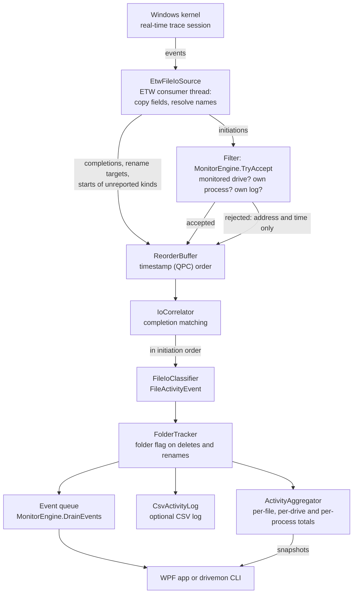

# Architecture

DriveMonitor is one engine, `MonitorEngine` in `src/DriveMonitor.Core`, with two front ends: the WPF app
(`src/DriveMonitor.App`) and the `drivemon` CLI (`src/DriveMonitor.Cli`). This document describes how the
engine turns the Windows kernel's file I/O trace into events and totals. Statements about TraceEvent 4.0.0
and the kernel trace come from reading TraceEvent's source and Microsoft's ETW documentation; the CI
self-test checks the most important of them on a real kernel.

## Components

| Type | File | Role |
| --- | --- | --- |
| `MonitorEngine` | `MonitorEngine.cs` | Owns the pipeline: lifecycle, filtering, publication, counters |
| `MonitorOptions` | `MonitorOptions.cs` | Session name, buffer size, completion wait, limits |
| `EtwFileIoSource` | `Tracing/EtwFileIoSource.cs` | The kernel trace session, its consumer thread and DriveMonitor's own name tables |
| `PendingIo` | `Tracing/PendingIo.cs` | The fields copied out of one kernel initiation event, plus its completion |
| `ReorderBuffer` | `Tracing/ReorderBuffer.cs` | Holds the source's events for a moment and passes them on in the order the kernel logged them |
| `IoCorrelator` | `Tracing/IoCorrelator.cs` | Matches completions and rename targets to their operations |
| `FileIoClassifier` | `Tracing/FileIoClassifier.cs` | Turns a matched operation into a `FileActivityEvent` |
| `NtStatusText` | `Tracing/NtStatusText.cs` | Short descriptions of NTSTATUS codes ("not found", "access denied") |
| `ProcessNameCache` | `Tracing/ProcessNameCache.cs` | Process ID to image name |
| `VolumeMapper` | `Volumes/VolumeMapper.cs` | Kernel paths to DOS paths |
| `DriveCatalog`, `StorageQuery` | `Volumes/` | Drive letters with type, bus, model, size and file system |
| `DriveFilter` | `Filtering/DriveFilter.cs` | The monitored drive letters |
| `ActivityAggregator` | `Aggregation/ActivityAggregator.cs` | Totals per file, per drive and per process |
| `FolderTracker` | `Aggregation/FolderTracker.cs` | The paths known to be folders, which give a folder's delete or rename the `Directory` flag |
| `CsvActivityLog`, `Csv` | `Export/` | The continuous CSV log, with its limits, and CSV export |
| `LinkSafeFolder` | `IO/LinkSafeFolder.cs` | Opens a folder, or the folders below a trusted root, and the files in it without following links (the app's settings, error log and logs folder, the activity log) |

Paths are relative to `src/DriveMonitor.Core`.

## Pipeline

1. **Kernel session.** `EtwFileIoSource` starts a real-time kernel session in system-logger mode with these
   kernel keywords:
   - `FileIOInit`: the initiation events (create, read, write, set information, delete, rename, cleanup,
     close, flush, folder enumeration, query information, file-system control, change notification);
   - `FileIO`: the `FileIo_OpEnd` completions, with the final NTSTATUS and the bytes transferred (only
     while `UseCompletionEvents` is on, the default);
   - `DiskFileIO`, plus `DiskIO`, which it requires: the events that bind a file name to a FileKey.

   TraceEvent adds the Process and Thread keywords itself. The kernel cannot filter file events by volume,
   so the session receives the file activity of the whole system.
2. **Copy.** The callbacks for initiation events copy the fields they need into a `PendingIo` (TraceEvent
   reuses its event objects), resolving the file name and the process name on the way. Initiations, accepted
   or not, and completions are counted in `KernelEvents`; the starts of the kinds DriveMonitor does not
   report, which are only passed on for matching (step 3), are not.
3. **Filter.** For every initiation event, `MonitorEngine.TryAccept` converts a path that is still in
   kernel form, then rejects it when the path is not on a monitored drive (an empty path is counted as
   `UnnamedEvents`), when it comes from DriveMonitor's own process and `ExcludeOwnProcess` is set, or when
   it is one of the engine's own CSV log files (`CsvActivityLog.IsLogFile`: the first file or a later
   part). A rejected initiation still passes its request address and timestamp to the correlator through
   `IFileIoSink.OnForeignBegin`, and so do the starts of the kinds DriveMonitor does not report: cleanup,
   close, query information, file-system control, change notification, and folder enumeration when listings
   are not captured. The engine ignores them while `UseCompletionEvents` is off. Completions and rename
   targets carry no file name of their own, so they go straight on to reordering and matching.
4. **Reordering.** With `UseCompletionEvents` on, the source reports starts, completions, rename targets
   and foreign starts through a `ReorderBuffer`, which holds each for up to `ReorderWindowMs` (750 ms) and
   passes them on in the order the kernel logged them (see [Reordering](#reordering)). `TryAccept` is not
   held: it runs as each event arrives.
5. **Completion matching.** `IoCorrelator` attaches completions and rename targets to their operations and
   releases the operations in the order they started (see [Completion matching](#completion-matching)).
6. **Classification.** `FileIoClassifier.Classify` turns each released operation into a
   `FileActivityEvent` (see [Classification](#classification)).
7. **Fan-out.** `MonitorEngine.Publish` passes the event through `FolderTracker`, which gives a known
   folder's delete or rename the `Directory` flag (see [Folder flag](#folder-flag)), records it in
   `ActivityAggregator`, writes it to the CSV log if one is running, and then adds it to a
   `ConcurrentQueue`. Statistics and the log come before the queue, so an event dropped from a full queue
   still counts in the totals and in the log.
8. **Front ends.** The app drains the queue on a UI timer and takes snapshots of the statistics that
   changed; the CLI drains it and prints each event.

### Classification

| Kernel operation | Becomes | Details |
| --- | --- | --- |
| Read, Write | `Read`, `Write` | Bytes from the completion (never more than requested, nor more than 4 GiB - 1 when no request size was recorded); the requested size when no completion was seen; 0 when it failed. The kernel's request size is unsigned, up to 4 GiB - 1; TraceEvent returns it as an `int`, which `PendingIo.RequestSize` converts back. `Paging` from `IRP_PAGING_IO` (0x2), `NonCached` from `IRP_NOCACHE` (0x1). |
| Create | `Create` or `Open` | From the completion: `FILE_CREATED` → Create "created", `FILE_OVERWRITTEN` → "overwritten", `FILE_SUPERSEDED` → "replaced", anything else → Open. Without a completion, inferred from the requested disposition ("new file requested", ...). `FILE_DIRECTORY_FILE` sets `Directory`. An Open that asked for neither `FILE_DIRECTORY_FILE` nor `FILE_NON_DIRECTORY_FILE`, as `FILE_FLAG_BACKUP_SEMANTICS` opens do, sets `MaybeDirectory`: it may have opened a folder. `FILE_DELETE_ON_CLOSE` sets `DeleteOnClose` unless the open failed. |
| Delete, or set information with class 13 or 64 | `Delete` | The requested state is in ExtraInfo; a request without the delete bit becomes `SetInfo` "delete cancelled", with the `DeleteCancelled` flag. |
| Rename, or set information with class 10 or 65 | `Rename` | Target from the path event when Windows sent one and it is on the same drive ("→ new path", or "moved to the Recycle Bin"), otherwise "renamed or moved" (see [Rename targets](#rename-targets)). |
| Set information with class 11 or 72 | `SetInfo` | "hard link created" or "hard link → target", with the same rule for the target. |
| Set information with class 20 | `SetInfo` | "size → N bytes", `SizeChange`, `Bytes` = the new size. |
| Other set information | `SetInfo` | Allocation size, valid data length, "attributes or timestamps", "short name changed", or "information class N". Class 14 (file-pointer moves) produces no event. |
| Flush | `Flush` | |
| Folder enumeration | `List` | `Directory`; "pattern X" unless the pattern is `*`. |

An operation without a completion has status `Unknown`. With one, it is `Success` when the NTSTATUS is a
success code, for a folder enumeration that ended with "no more files" or "no such file", or for a read that
ended with `STATUS_END_OF_FILE` (0xC0000011: the read started at the end of the file and moved 0 bytes, as
the last read of every read-until-empty loop does; the NTSTATUS stays on the event). Otherwise it is `Failed`
and its detail becomes the reason from `NtStatusText`; a write that ends with `STATUS_END_OF_FILE` fails.

### Statistics

`ActivityAggregator` keeps the totals per file, per drive and per process. Failed operations are only counted
(`FailedEvents`), and paging I/O goes into separate paging totals and is never attributed to a process.

- **Folders** get a file row only when they are created, deleted or renamed; their opens and listings would
  flood the table while someone browses. Windows reports the delete or rename of a folder without the folder
  flag, and a `MaybeDirectory` open can take a folder or a file, so the type comes from evidence. A path is a
  folder when an event carries `Directory` or lists it, and a file when something creates it without
  `FILE_DIRECTORY_FILE`, opens it with `FILE_NON_DIRECTORY_FILE`, or reads, writes or resizes it (not paging
  I/O, which can reach a folder's index). Folders seen opened as folders, or listed, are remembered without a
  row, so a later delete or rename of the path gives a folder row, and the type of an existing row follows
  later evidence. A rename whose new path Windows reported gives that path the type of what was renamed: the
  source row's, or without a row the event's flag or the remembered folders. A `MaybeDirectory` open creates
  no row unless it deletes; on an existing row it counts as an open. The engine's `FolderTracker` applies the
  same evidence before an event is published (see [Folder flag](#folder-flag)), so the delete or rename that
  gives a folder row normally carries the `Directory` flag in Live activity and the CSV files too. One
  difference remains: a path deleted or renamed away as a folder keeps its folder row, while the engine
  forgets the path.
- **Time order.** Events are published roughly, not strictly, in time order: the kernel delivers each
  processor's buffer on its own, up to a flush interval apart, and the reorder buffer restores the order only
  within its window, and not at all without completion events. A file's or process's first seen therefore
  takes the earliest timestamp, and last seen, last operation and a drive's last activity the latest. The last
  process follows the latest event that is not paging I/O, the new name of the last rename the latest rename,
  and the Deleted status the latest create, delete, delete-on-close or cancel. Of two events with the same
  timestamp, the one recorded last wins.
- **Cancelled deletes.** A `DeleteCancelled` event clears the Deleted status. This follows the usual single
  handle: another handle opened with delete-on-close would still delete the file.
- **Limits.** At most `MaxTrackedFiles` (200,000) files and 50,000 processes get rows (`ActivityAggregator`'s
  `maxTrackedProcesses`; `MonitorEngine` passes only `MaxTrackedFiles`, so the process limit keeps its
  default). Events of new files beyond the limit still count in the drive and process totals and in
  `UntrackedEvents`; events of new processes still count in the drive and file totals and in
  `UntrackedProcessEvents`. The folders remembered without a row are bounded by `MaxTrackedFiles` too, and
  start over when full. `TrackedFiles` and `TrackedProcesses` give the number of rows.
- **Process names per file.** A row's Processes text names three processes and adds "+N more". The file
  keeps 16 names and counts up to 4,096 more; once there are more than three, `FileStatsSnapshot.ProcessNames`
  holds all of them, so the app's Files search can match any of them.

### Folder flag

Windows reports a folder's delete or rename without the folder flag: `RemoveDirectoryW` opens the folder with
`FILE_DIRECTORY_FILE` and then sends a disposition that names no type, and `MoveFileEx` and `IFileOperation`
open the source without that option. `MonitorEngine.Publish` therefore passes every classified event through
`FolderTracker` before the statistics, the log and the queue see it.

- **Learning.** A path becomes a folder when it is opened or created with `FILE_DIRECTORY_FILE` or listed,
  and stops being one when it is created as a file, opened with `FILE_NON_DIRECTORY_FILE`, or read, written
  or resized (not paging I/O): the statistics' evidence (`ActivityAggregator.FolderEvidence`). Failed
  operations teach nothing. `Classify` never returns null for a create, open or listing, so every folder open
  teaches the tracker, even one whose event a full queue later drops.
- **Flag.** A delete or rename of a known folder is published as a copy with `FileEventFlags.Directory`,
  failed or not. The CSV files write it in their Flags column, and Live activity adds "folder" to the
  details; `drivemon`'s lines have no folder marker.
- **Forgetting.** Only a delete or rename that succeeded forgets the path. One whose outcome is unknown leaves
  it known: on FAT, Windows retries a rejected delete or rename with the older form of the request, which
  must still find the folder, and without completion events every outcome is unknown. A rename whose new path
  Windows reported, and that did not fail, gives the new path the type of the old one: a renamed folder is
  known at its new name, and a file renamed onto a stale folder path clears it.
- **Not covered.** Paths below a deleted or renamed folder are left as they are; Windows deletes only an
  empty folder, and below a renamed one the new paths are learned when they are next opened as folders or
  listed. A rename of a folder that was not opened as a folder, created or listed since the engine was
  created or since `ClearStatistics` is published as a file's.
- **Limits.** At most `MaxTrackedFiles` (200,000) paths, starting over when full, which keeps the folders
  seen last. `ClearStatistics` clears them together with the statistics; `Start` does not. Events that
  cannot change anything (paging I/O, metadata changes, flushes, opens that take either type) return at once;
  the others cost a hash lookup or two under the tracker's lock.

## Threading model

| Thread | What runs there |
| --- | --- |
| ETW consumer (`DriveMonitor ETW consumer`, background, above-normal priority so kernel buffers do not overflow) | TraceEvent's `Process()` loop and every callback: copying fields, the name tables, the path mapper, `TryAccept`, and adding each start, completion and path to the reorder buffer, which passes on what is due to the correlator's `Begin`, `Complete` and `Annotate`, each followed by releasing the operations that are ready |
| Reorder timer (thread pool, one-shot) | Passes on held events that have fallen due when nothing arrives; set only while events are held, at least 50 ms ahead |
| Release timer (thread pool, every 250 ms) | Releases operations whose wait for a completion ran out |
| Flush timer (thread pool, every `FlushIntervalMs`, 500 ms by default; every second when it is 0) | `session.Flush()` (not when `FlushIntervalMs` is 0), so Windows hands over buffered events sooner than the 1 s flush timer TraceEvent sets for the session; then it reads the session's lost-event count, which can no longer be read once another program has stopped the session |
| CSV log writer (thread pool task) | Drains a bounded channel into the log file, so a slow disk never stalls the consumer; the only code that writes or closes the log's files (see [Activity log](#activity-log)) |
| Fault handler (thread pool) | Retires a failed session and restarts or reports it |
| App UI thread | Every 250 ms: drains up to 50,000 events into Live activity and applies the statistics that changed. Every second: re-sorts the sorted tables whose rows changed in place, never sooner than ten times as long as the last re-sort took. When Windows reports a new volume: refreshes the volume map |
| App thread pool | `Start` and `Stop`, drive enumeration, exports, starting and stopping the log, File Explorer, and the shutdown when the window closes (see [Closing the app](#closing-the-app)) |
| CLI main thread | Every 200 ms: drains the queue and prints. Without `--drives`, it also checks for new drive letters; when one came or went, and every 10 seconds, it refreshes the volume map and reads the drive list |

Publication (classification, folder flag, statistics, log, queue) runs on whichever thread releases the
operation (the consumer thread, the reorder timer, the release timer, or the thread that stops the session)
and under `_correlatorLock`, so events are published one at a time and in initiation order. With
`UseCompletionEvents` off, nothing is matched or held, and the consumer thread publishes each operation as
it starts, without taking that lock.

How the threads share state:

- `_lifecycleLock` serialises `Start`, `Stop` and fault handling.
- The reorder buffer has a lock of its own and calls the engine under it, one event at a time. The order is
  always `_lifecycleLock`, then the buffer's lock (when `Stop` drains the buffer), then `_correlatorLock`;
  nothing takes the buffer's lock while it holds `_correlatorLock`.
- `_correlatorLock` guards the correlator and publication. `PendingCompletions` is the exception: the
  correlator publishes its number of waiting operations with `Volatile.Write`, so the app's diagnostics,
  refreshed every second, read it without waiting for the lock that the ETW consumer holds. It does not
  count the events the reorder buffer still holds.
- `FolderTracker` has its own lock, so that `ClearStatistics`, called from the UI thread, can clear it.
- `ActivityAggregator` has one lock, held briefly by `Record` and by the snapshot methods. The UI asks only
  for what changed since its last call (`TakeChangedFiles`, `TakeChangedProcesses`).
- `EtwFileIoSource._sessionLock` guards the session reference, `EventsLost` and `Flush`.
- The name tables are touched only on the consumer thread.
- Lock-free: the monitored drives are a 26-bit mask (`Interlocked` writes, `Volatile` reads); the volume
  map is an immutable snapshot replaced atomically; process names are a `ConcurrentDictionary`; counters
  use `Interlocked`; the running source and the totals of retired sources are one record swapped as a
  unit; `ExcludeOwnProcess` is volatile and is the only option that may change while monitoring.
- `Faulted` and `Restarted` are raised on a worker thread, and `StateChanged` on the thread that started or
  stopped monitoring; the app posts all three to the UI thread with `Dispatcher.BeginInvoke`.

## Completion matching

A kernel initiation event (create, read, write, set information, delete, rename, flush, folder
enumeration) and its `FileIo_OpEnd` completion carry the same request address, `IrpPtr` (Filter Manager
callback data). Each event also has an exact QueryPerformanceCounter timestamp. Two things make the pairing
hard:

- **Out-of-order delivery.** A real-time session delivers each CPU's buffer independently, so a completion
  logged on one CPU can arrive before the initiation logged on another.
- **Address reuse.** Windows recycles request addresses within microseconds, so a completion can belong to
  an older or a newer use of the same address.

The rule that resolves both: **an address serves one operation at a time, so a completion C belongs to
initiation B on the same address only if C was logged at or after B and no other operation started on the
address in between; among those candidates the closest one wins.** In detail:

- **Every start counts.** The rule needs the starts of the operations DriveMonitor does not follow too:
  those on other drives, of excluded processes or of its own log, and every cleanup, close, query, file-system
  control and change notification, whose completions arrive on the same recycled addresses. `EtwFileIoSource`
  reports them through `OnForeignBegin` (step 3 of the [pipeline](#pipeline)). Each waiting operation keeps
  `ReusedQpc`, the earliest start known on its address after its own. Every start, followed or not, lowers
  it on the latest waiting operation that began before it; each earlier operation is already limited by the
  start of the one after it, so this normally takes one step. The latest start on each address is also
  remembered, in two generations of 65,536 addresses each (the older is dropped when the newer is full), so
  that an initiation delivered after a later start takes its limit from that start, or from a waiting
  operation that began after it. Releasing everything, at `Stop` or when a failed session is retired, clears
  this table.
- **Waiting operations** are chained per address, in a doubly linked chain sorted by start, latest first,
  so one leaves in constant time when it completes or expires. A completion goes to the latest operation on
  its address that started at or before the completion's timestamp, unless it was logged at or after that
  operation's `ReusedQpc`; then it goes to the early store instead.
- **Early store.** A completion that matches nothing yet is kept, keyed by address, for `CompletionWaitMs`
  (2,000 ms), in case its initiation is still in flight. When an initiation arrives, it takes the earliest
  stored completion on its address that was logged at or after its own timestamp, unless that one was logged
  at or after its `ReusedQpc`. Completions of operations that are not followed (their initiations were
  filtered out, or are of a kind DriveMonitor does not report) also land here and simply expire. Each stored
  value is on two doubly linked lists: its address's chain, sorted by timestamp, and one list of all values
  in arrival order, which expiry and the cap of 500,000 values work through. A value leaves either list in
  constant time; an insert walks from the latest end, which takes no steps when values arrive in order; and
  a lookup stops at the first value logged before the initiation. At most 1,024 values are kept per address;
  beyond that, the earliest logged is dropped.
- **Release order.** Operations leave the correlator in initiation order. An operation is released as soon
  as it is complete and everything before it has been released; an incomplete one waits up to
  `CompletionWaitMs` and is then published with status `Unknown`. An operation without a request address
  never waits, because nothing could be matched to it. `Stop` releases everything at once.
- **Rename targets** use the same rule, `ReusedQpc` included. Once the engine has seen one
  `FileIo_PathOperation` event, renames and hard-link operations wait for their path as well as their
  completion (up to the same 2,000 ms). A path that arrives first waits in a second early store; a path for
  an operation that was not told to wait (it started before the first path event) is still attached while
  that operation waits for its completion.
- With `UseCompletionEvents` off, nothing is matched: operations are published as they start.

Every completion in the system passes through the correlator, and recycled addresses put thousands of them on
a few hot addresses, so nothing here walks a whole chain: a burst of I/O on an unmonitored drive cannot stall
the consumer thread, which takes `_correlatorLock` for every completion. An operation whose own completion
never arrives is published as `Unknown` (a rename: without its target) instead of with the outcome of an
operation that reused its address.

In arrival order, two gaps would remain. A start delivered after the completion that it would rule out comes
too late, and an initiation delivered after several later starts on its address knows only the latest of
them. The first gap can mismatch even two followed operations on one address: when the second one's
completion is delivered before the first one's start, and the second start and the first completion only
after that, the first operation takes the second one's completion and the second ends `Unknown`. The reorder
buffer closes both gaps by handing the correlator every event in timestamp order (see
[Reordering](#reordering)). They remain only for events that Windows delivers later than the reorder window,
for events passed on early because the buffer was full, and with `ReorderWindowMs` set to 0. A rename or
hard-link target on another drive is dropped by the classifier whatever the correlator matched (see
[Rename targets](#rename-targets)).

### Reordering

A real-time session hands over each processor's buffer separately, when it is full or flushed, so events
arrive out of timestamp order by up to about the flush interval. In timestamp order every start on an address
reaches the correlator before the completions and paths logged after it, so each completion pairs with the
latest start before it. With `UseCompletionEvents` on and `ReorderWindowMs` above 0, `EtwFileIoSource`
therefore reports to the engine through a `ReorderBuffer`. `TryAccept` goes straight through; starts,
completions, rename targets and foreign starts are held:

- **Release rule.** An event is passed on once an event logged at the same time or later arrived at least
  `ReorderWindowMs` ago. As long as no event arrives more than a window after one logged later than it,
  everything logged before an event has arrived by the time that event is passed on. Events with equal
  timestamps keep their arrival order, which for one processor is the order they were logged. An event logged
  before one that was already passed on goes on at once: it is too late to be put in order, and the
  correlator's early stores, `ReusedQpc` and out-of-order inserts handle it as before.
- **Window.** `ReorderWindowMs` defaults to `FlushIntervalMs` plus 250 ms: 750 ms, or 1,250 ms when
  `FlushIntervalMs` is 0 and TraceEvent's own flush, once a second, applies. It follows `FlushIntervalMs`
  until it is set. A flush that Windows delivers late on a busy system, or a consumer that stalls for more
  than about 250 ms, uses up the margin, and the events concerned fall back on the correlator's own rules.
- **Timer.** Arrivals pass on what is due. When nothing arrives, a one-shot timer does, set for when the
  oldest arrival still counted falls due and at least 50 ms ahead, so a quiet system still publishes.
- **Cost.** Events wait in a heap ordered by timestamp and arrival number, 48 bytes each, O(log n) to add or
  take, with nothing allocated per event. Arrival times are kept per clock tick, so that record grows with the
  window, not with the event rate. At most 250,000 events are held (about 12 MB); beyond that the earliest
  logged is passed on early and counted in `MonitorEngine.ReorderOverflows`, which adds up the sources across
  restarts.
- **Errors.** An exception the engine throws while an event is passed on costs only that event and is
  counted in `CallbackErrors`, on the timer thread too.
- **Stop.** `EtwFileIoSource.Stop` passes on everything still held, in timestamp order, once the consumer
  thread has delivered its last event, so the engine's final release finds it all. A restarted session's
  source has a buffer of its own, and events from a consumer that outlived `Stop` go straight through.
- **Delay.** Events reach the correlator, and so the statistics, the log and `DrainEvents`, about 0.75
  seconds later than they would without reordering. `StopLog` and `ClearStatistics` act at once, so events
  from about the last second before them are published afterwards: the stopped log does not get them, and the
  cleared statistics count them. The window does not shorten `CompletionWaitMs`: the time the correlator sees
  between a start and its completion is at most the time between the start's logging and the completion's
  arrival.

## Name resolution

### File names

The kernel names files in two kinds of events:

- `FileIo_Create` carries the path being opened; TraceEvent associates it with the FILE_OBJECT of that open.
- The `FileIo_Name` events (Name, FileCreate, FileRundown) bind a name to a FileKey, the file system's
  per-stream context that every open of the stream shares. `FileIo_Name` FileDelete (opcode 35) means that
  binding was released; it does not mean a file was deleted. Deletes come from `FileIo_Delete` and from
  disposition requests.

Read, write, set-information, delete, rename, flush and folder-enumeration events carry only the FileKey
and the FileObject. TraceEvent looks them up in its own table, FileKey first, but in a real-time session it
forgets a FileObject's name at Cleanup (the last handle closed) and a FileKey's name when the name is
released and at rundown. Paging I/O, such as the lazy writer flushing a file that was already closed, can
arrive after that. `EtwFileIoSource` therefore keeps two tables of its own:

- **By FileKey:** filled from the Name, FileCreate and FileRundown events, and learned from any event whose
  name TraceEvent did resolve, so that later cache flushes through another file object can be named.
  Removed when the name is released.
- **By FileObject:** filled from `FileIo_Create`. Removed at Close (the file object is freed), not at
  Cleanup, because paging I/O can still use the file object after its last handle closed.

A name is resolved in this order: TraceEvent's name, the FileKey table, the FileObject table. When all three
fail, the path is empty: the event cannot be tied to a drive and is counted as unnamed. Each table holds at
most 500,000 entries and is cleared when it is full; entries normally leave at Close or name release, so the
cap only guards against lost events.

### Files that were already open

A file opened before the session started produces no Create or Name event. After the session is running,
DriveMonitor enables the kernel rundown provider `{3b9c9951-3480-4220-9377-9c8e5184f5cd}` with keyword 0x10
(`KERNEL_FILE_KEYWORD_FILENAME`) on it, which makes the kernel list the names of open files (FileIo opcode
36). This is not documented by Microsoft; the technique comes from System Informer. Because TraceEvent drops
a FileKey's name at rundown, these names survive only in DriveMonitor's own FileKey table. If Windows
ignores the request, those files stay unnamed until they are opened again. The app's diagnostics ("Names of
already open files requested") and the self-test's "name rundown requested" say whether Windows accepted
the request, not whether it acted on it.

### Rename targets

The kernel's rename event carries no new name. Windows 11 also sends undocumented `FileIo_PathOperation`
events (opcode 80 for a rename, 81 for a hard link), which TraceEvent 4.0 does not parse. DriveMonitor reads
them from TraceEvent's unhandled events and parses the payload itself: `IrpPtr`, `FileObject`, `FileKey` and
`ExtraInfo` (pointer-sized), `TTID` and `InfoClass` (32-bit), then the NUL-terminated UTF-16 name. A name
that is not a kernel path is ignored; the rest are converted to DOS paths and matched to their operation by
request address and timestamp. `PathOperationsSeen` (the app's "Windows reports new names of renamed files")
turns true at the first such event.

The classifier uses a target only when it is a DOS path on the operation's own drive that names something
other than the old path:

- **Same drive.** A rename or hard link cannot leave its volume, so a target on another drive can only be the
  path event of an unrelated operation matched through a recycled request address. The event is then
  reported without a target ("renamed or moved", "hard link created") rather than with a wrong one. Drive
  letters are compared without case; moves to the drive's own Recycle Bin are kept.
- **Case.** The folders above the last name are compared without case, as Windows looks them up, and the
  last name with case: Windows keeps the case a name is given, so renaming `E:\photos` to `E:\Photos` is
  reported with its target, while a target that differs only in the case of a folder above the name is the
  old path and is dropped.

### Process names

`ProcessNameCache` is filled from process start events and from the list of running processes the kernel
sends when the session starts. The kernel's image name is cut to 15 characters (`SearchProtocolH`), so the
executable name from the command line wins when it extends the short name. For a process the trace has not
named, DriveMonitor asks Windows (`QueryFullProcessImageName` with `PROCESS_QUERY_LIMITED_INFORMATION`),
then falls back to TraceEvent's name or `PID n`; PID 0 is `Idle` and PID 4 is `System`. An operation is
attributed to the process and thread of its initiation event, never to those of its completion.

Whoever starts a process chooses its command line, and a program's file name can hold characters that
change how text is shown. A name from the command line is therefore used only when it has no character that
a Windows file name cannot contain (`Path.GetInvalidFileNameChars`) and none of the characters below;
otherwise the kernel's short name is kept. Every name the cache stores, from any source, goes through
`SafeName`, which replaces C0 and C1 control characters, DEL, the Unicode line and paragraph separators
(U+2028, U+2029) and the bidirectional marks, embeddings, overrides and isolates (U+061C, U+200E, U+200F,
U+202A to U+202E, U+2066 to U+2069) with `?`. The app, `drivemon` and the CSV files therefore show the same,
clean name; `drivemon`'s `ConsoleText` replaces the same characters again before printing.

## Kernel-to-DOS path mapping

The kernel reports paths such as `\Device\HarddiskVolume5\docs\a.txt`; DriveMonitor shows `E:\docs\a.txt`.

- **The map.** `VolumeMapper` asks `QueryDosDevice` for the device behind each letter A to Z. SUBST drives,
  which point at `\??\C:\folder`, are skipped, and a volume with several letters maps to the first one.
- **Installed in TraceEvent.** TraceEvent converts a name once, when it decodes the Create or Name event,
  through `KernelPathToUserPathMapper`. Its default mapper reads the drive letters once and never learns
  about drives added later, so `EtwFileIoSource` replaces it with `VolumeMapper.ToDosPath` before
  `Process()` starts. The mapper never throws or returns null, returns DOS paths unchanged (so mapping twice
  is harmless) and leaves non-paths such as a `*` search pattern alone.
- **Refreshable.** Lookups read an immutable snapshot; `Refresh()` builds a new one and swaps it in
  atomically. The map is refreshed at every start and restart; by the app as soon as Windows reports a new
  local volume, and again when a volume arrived or was removed (`WM_DEVICECHANGE`, debounced by 750 ms),
  before it reads the drive list again; by `drivemon` without `--drives` each time it reads the drive list
  (when a drive letter came or went, and every 10 seconds); and automatically when a lookup misses on a
  device that looks like a storage volume (`HarddiskVolumeN`, `CdRom`, `Floppy`, but not shadow copies), at
  most once every 2 seconds.
- **Remapped when an event arrives.** A name recorded before its volume had a drive letter, for example on a
  pendrive that was just plugged in, is still a kernel path. `TryAccept` converts any path that still starts
  with `\` again each time an event uses it.
- **Other forms.** `\??\E:\x` and `\\?\E:\x` become `E:\x`; `\??\UNC\server\share\x`,
  `\Device\Mup\server\share\x` and `\Device\LanmanRedirector\server\share\x` become `\\server\share\x`;
  `\SystemRoot\...` becomes the Windows directory. Paths that cannot be mapped (named pipes, volumes without
  a letter, shadow copies, the redirector paths of mapped network drives) stay in kernel form. Neither these
  nor `\\server\share` paths have a drive letter, so they never match a monitored drive.

## Activity log

`CsvActivityLog` writes every published event to a CSV file: the app's **Record log** and `drivemon --csv`.
`MonitorEngine.Publish` hands it each event with `Write`, which never blocks: the event goes into a bounded
channel of 100,000 events, or is counted in `Dropped` when the channel is full or the log has ended.

- **One owner.** Once the constructor returns, a background task is the only code that writes or closes the
  log's files. It formats the rows itself, collects them into chunks of up to about 64 KB and writes each
  chunk with `WriteAsync` once it is full or no more events are waiting, on an unbuffered `FileStream` opened
  with `FileOptions.Asynchronous`, so a write stuck on a stalled drive can be cancelled and closing a file
  never flushes. `Written` counts the rows whose write completed.
- **Parts.** At `MaxLogFileMB` (100 MB) the log continues in a new file, a part, named like the first with
  `.002`, `.003` and so on before the extension: `activity.csv`, `activity.002.csv`, and so on. Each part
  starts with its own byte-order mark and header row and holds whole rows; a part exceeds the limit only when
  a single row does. `CurrentFilePath` names the part being written. `IsLogFile` recognises the first file
  and every later part, and `TryAccept` uses it to leave the log's own writes out of the events (the lazy
  writer flushes them as the System process, so the process filter alone would not).
- **Number of parts.** Starting a part deletes the oldest parts of this log, so that at most `MaxLogFiles`
  (10) remain: about 1 GB of one recording by default. Only parts this log created are deleted; one that
  another program holds open is kept and tried again before the next part, and so is one whose name a link,
  a folder or a hard-linked file has taken over, which is never deleted. Files of other logs are never
  deleted: each of the app's recordings has its own timestamped name, and parts left by an earlier `drivemon`
  run with the same `--csv` path stay until a new part of the same name replaces them.
- **Links.** The log runs as administrator, often in a folder that other users can change (the root of a
  pendrive, a shared folder) and under names they can predict, so it opens no file by path. Given a trusted
  root (`trustedRoot`, the last parameter of the constructor and of `StartLog`; the app passes
  `%LOCALAPPDATA%`), the file must be below it, or the constructor throws `ArgumentException` (*'\<file>' is
  not in '\<root>'.*) before the free-space check and before any folder is created or opened. The folder is
  then opened, and created when missing, with `LinkSafeFolder.OpenBelow`, which follows no link below the
  root (see [Front ends](#front-ends)): a junction, symbolic link or mount point on the way, such as
  `%LOCALAPPDATA%\DriveMonitor`, makes it throw an `IOException` that names it. Without a root
  (`drivemon --csv`, a path the user chose), the constructor creates a missing folder by path
  (`Directory.CreateDirectory`) and opens it with `LinkSafeFolder.Open`, which refuses a junction, symbolic
  link or other reparse point at the folder itself; links in the folders above it are followed, so they
  decide which folder the log opens. Either way the log holds the folder's handle without
  `FILE_SHARE_DELETE` until the background task ends, on `Dispose` or on an error: meanwhile nobody can
  rename, delete or replace the folder, not even between two parts. Each part is opened relative to that
  handle with `FILE_OPEN_REPARSE_POINT` (`FileMode.OpenOrCreate`); a file already at the name must be a plain
  file with exactly one name, and it is emptied only after that check. Old parts are deleted with
  `LinkSafeFolder.DeleteFile`, through the handle of the file it checked. A name that is a link, a folder or a
  file with more than one name is refused: for the first part the constructor, and so `StartLog`, throws an
  `IOException` that names the file, such as *'E:\log.csv' has other names (hard links); it is not used.*;
  for a later part the log stops with that error. A path that ends in a backslash, or a drive root, is
  refused with *'\<path>' is a folder, not a file.* FAT and exFAT have neither reparse points nor hard links;
  on a network share the checks rest on the server.
- **Free space.** The constructor throws `IOException`, and creates no file, when the log's drive has less
  than `MinLogFreeSpaceMB` (512 MB) free. While logging, the free space is checked at most once a second and
  before every new part; below the minimum the log stops with an `IOException` in `Error` (its `HResult` is
  0x80070070, `ERROR_DISK_FULL` as an HRESULT), such as *Only 300 MB is free on C:\\; the activity log stops
  when less than 512 MB is left.* The free space comes from `DriveInfo`, so a log on a network (UNC) path is
  not checked; a full share still stops it with its write error.
- **Errors.** Any write error (disk full, drive removed, network share gone), and a link found at a later
  part's name, ends the log in order: it refuses later events, so that `Write` counts them as dropped; it
  counts the rows it had buffered and the events still queued as dropped; it closes the file and the folder;
  and only then does it set `Error`, so whoever sees `Error` also sees the final counts. `Error` does not
  change once set.
- **Dispose** completes the channel and waits as long as the log makes progress. It gives up after 5 seconds
  without a completed write, or after 30 seconds in all: it cancels the stuck write and counts whatever will
  never be written as dropped, and `Error` becomes a `TimeoutException` (*The drive stopped accepting the
  activity log; events not yet written were dropped.*). Normally the cancelled write ends at once and the
  background task sets that error itself. When the task is still blocked 1 second later (a write the driver
  does not cancel, or a free-space query, open or close that cancelling cannot reach), `Dispose` sets the
  error itself and returns without waiting for it; the rows that call holds are counted when it returns.
  `Dispose` never touches the file and never throws. `StopLog`, `MonitorEngine.Dispose`, the end of a
  `drivemon` run and closing the app can therefore take up to 30 seconds on a slow drive.

The three limits are `MonitorOptions` settings, read when a log starts; 0 turns each one off, and the app and
`drivemon` keep the defaults. The app shows `Written`, `Dropped` and `Error` in its diagnostics, reports a log
that cannot start or that stops (*Could not start the activity log: ...*, *The activity log stopped: ...*)
and turns **Record log** off. `drivemon` reports a log that cannot start (*Cannot write the CSV file: ...*)
and exits with 1. Its `CsvLogStatus` watches the log during the run: it reports a log that stopped on
stderr as soon as the 200 ms monitoring loop sees `Error`, stops the log with `StopLog` before the summary
(printing *Finishing the CSV log...* when that takes more than a second), reports a failure it has not
reported yet, adds a line with the files, the rows written and dropped and the error to the summary, and
makes the exit code 1 when `Error` is set. The app reads `Error` only from the log the engine still holds,
so a log that fails while **Record log** is being turned off, or while the app closes, is not reported there.

## Session lifecycle

### Start

`MonitorEngine.Start`, under `_lifecycleLock`:

1. Throws `ObjectDisposedException` once the engine is disposed, returns if it is already running, and
   throws `MonitorStartException` when the process is not elevated.
2. Takes the cross-process guard, or decides to go on without it, and sets `StartWarning` accordingly
   (below).
3. Refreshes the volume map and starts a new `EtwFileIoSource`:
   1. `new TraceEventSession(name, TraceEventSessionOptions.Create)` with `StopOnDispose` and `BufferSizeMB`.
      `Create` replaces a leftover session with the same name, for example one left behind by a crash.
   2. **`EnableKernelProvider` first.** With a custom session name, TraceEvent starts the session here, as a
      system logger. Reading `session.Source` first would start an ordinary session that cannot take kernel
      keywords.
   3. Reads `session.Source` exactly once. Reading it again after `Dispose` would silently start a new
      session that nothing stops.
   4. Installs the path mapper and subscribes the callbacks.
   5. Starts the consumer thread, requests the file-name rundown and starts the flush timer, which runs even
      when `FlushIntervalMs` is 0 (then every second, only to read the lost-event count).

   A failure in steps 1 to 4, the session's constructor included, disposes the half-built session (when
   one was created) and is rethrown as a `MonitorStartException` with a readable message: access denied becomes "Administrator rights are
   required...", `0x800705AA` (`ERROR_NO_SYSTEM_RESOURCES`) becomes "Windows has no free kernel trace
   session..." (Windows runs at most eight system-logger sessions, and two of the slots are reserved), and
   anything else becomes "The kernel trace session could not be started: ...".
4. Starts the release timer, subscribes to `AppDomain.ProcessExit`, marks the engine running and raises
   `StateChanged`.

### Stop

`MonitorEngine.Stop` disposes the release timer, unsubscribes from `ProcessExit`, stops the source (which
passes on what its reorder buffer holds), adds its counters to the totals of retired sources, marks the
engine stopped and releases the guard. Then, outside the lock, it publishes every operation still waiting for
a completion and raises `StateChanged`.

`EtwFileIoSource.Stop` works in the order **Stop, then join, then Dispose**:

1. It marks the source as stopping, disposes the flush timer and records the final `EventsLost`. When another
   program has already stopped the session, that read fails, and the count the flush timer read last, at
   most one tick old, stays.
2. `session.Stop()`: the kernel delivers what is still buffered, and `Process()` returns by itself.
3. It joins the consumer thread, for up to 5 seconds (not when called on that thread).
4. It disposes the session. Disposing closes the consumer and discards undelivered events, which is why it
   comes after the drain. If the join timed out, it joins once more, for up to 5 seconds.
5. Last, it disposes the reorder buffer, which passes on everything it still holds, in timestamp order, so
   the engine's final release finds it. From then on, events from a consumer that outlived `Stop` go
   straight to the engine.

### Dispose

`MonitorEngine.Dispose` first marks the engine as disposed under `_lifecycleLock`, then stops monitoring and
the log (up to 30 seconds on a slow drive; see [Activity log](#activity-log)). A `Start` that takes the lock
afterwards throws `ObjectDisposedException`, so a start racing with `Dispose` (for example the window closing
while auto-start is still creating the session) cannot leave a kernel session that nothing would stop. A
faulted session is never restarted once the engine is disposed, and calling `Dispose` again is harmless.
`StartLog` also throws `ObjectDisposedException` once the engine is disposed, before it creates anything. A
log that it is still creating when `Dispose` runs (for example when the window closes while **Record log**
starts) does not stay open either: `Dispose` marks the engine before its own `StopLog`, and both swap the
current log atomically, so either that `StopLog` ends the new log or `StartLog`, which looks at the mark
again once it has swapped the log in, sees it. When it sees the mark, `StartLog` ends the log itself if
`Dispose` has not, and then throws `ObjectDisposedException`.

### The cross-process guard

TraceEvent's `Create` option replaces a running session that has the same name, which would silently end
another DriveMonitor's monitoring. `Start` therefore takes a machine-wide named semaphore,
`Global\DriveMonitor.Session.<session name>`, with a count of one. `Stop`, and a fault that ends monitoring,
release it; as a kernel object it also disappears when the process holding it exits.

Creating or holding that semaphore needs no privilege, so any user could take it first to keep DriveMonitor
from monitoring; only starting the kernel session needs administrator rights. So when the guard cannot be
taken (another process holds it, or another program created the name as another kind of object or with an
access list that shuts DriveMonitor out), the trace session decides. `Start` asks Windows for the running
sessions (`TraceEventSession.GetActiveSessionNames`):

- **A session with this name is running:** another DriveMonitor is monitoring, and `Start` fails with
  *Another DriveMonitor window or command is already monitoring with the session "\<name>". Close it first.*
- **None is running:** `Start` asks again every 200 ms for up to 2 seconds, because a DriveMonitor that has
  just taken the guard, or is restarting its session, has no session for a moment. A session that appears
  means the refusal above; a guard released in the meantime is taken. Otherwise the guard is stale or held
  to block monitoring: `Start` goes on without it and sets `MonitorEngine.StartWarning` to *Another program
  holds Global\DriveMonitor.Session.\<name>, which keeps two DriveMonitors from sharing the session "\<name>",
  but no such session is running, so monitoring started anyway.* While the other program keeps the guard, a
  DriveMonitor started later finds this one by its session and refuses. The app shows `StartWarning` in an
  amber banner until monitoring stops (`MainViewModel.ShowStartWarning`); `drivemon` prints it once on stderr
  after the start (`LiveMonitor.ReportStartWarning`), in live monitoring and in the self-test.
- **The sessions cannot be listed:** `Start` refuses, with *Could not check whether another DriveMonitor is
  running: ...* when the guard could not even be opened, and with the message above otherwise.

| Session name | Used by |
| --- | --- |
| `DriveMonitor-FileIO` | The app (the `MonitorOptions` default) |
| `DriveMonitor-CLI` | `drivemon` |
| `DriveMonitor-SelfTest` | `drivemon --self-test` |

Because the names differ, the app and the CLI can monitor at the same time, each with its own kernel
session. Separately, the app allows one window per Windows session through the mutex
`Local\DriveMonitor.App.SingleInstance`. Any program in the Windows session can hold that name too, so when
the app cannot take the mutex (it waits up to 10 seconds when started by **Restart as administrator**), it
looks for another process with its own image name in the same Windows session whose token is elevated;
`DriveMonitor.exe` always runs elevated, because its manifest requires it. Only if there is one does the app
say *DriveMonitor is already running.* and exit; otherwise it runs without the mutex. A process whose
elevation cannot be read counts only when the app itself is not elevated, because a process that is not
elevated cannot look at an elevated one.

### Faults and auto-restart

If `Process()` returns although nobody called `Stop` ("The kernel trace session was stopped by another
program."), or throws, the source raises `Faulted` on the consumer thread. Stopping joins that thread, so the
engine hands the fault to the thread pool. There, under `_lifecycleLock`, it ignores the fault when the
engine is disposed or stopped or the source is no longer current; otherwise it retires the failed source,
which passes on what its reorder buffer holds, and publishes what was waiting. If `AutoRestart` is on and
fewer than three restarts were attempted in the last 60 seconds, it refreshes the volume map, starts a new
source and raises `Restarted`; the app shows a banner and the CLI a message, because events in between may
be missing. Otherwise it stops, releases the guard and raises `Faulted`.

Every callback catches its own exceptions, because one escaping into TraceEvent would end the session. It
counts them in `CallbackErrors` and keeps the last message in `LastCallbackError`; each costs one event, not
the session. The self-test fails if any occurred.

### Process exit

.NET does not run finalizers at exit, and a kernel session outlives the process that started it. `Start`
therefore subscribes to `AppDomain.ProcessExit`, whose handler calls `Stop`, once the session is running.
The app also stops and disposes the engine when its window closes and when Windows logs off or shuts down
(see [Closing the app](#closing-the-app)), and disposes it first in its unhandled-exception handlers.

`drivemon` stops the engine from an `AppDomain.UnhandledException` handler, because a crash on a worker
thread, such as the release timer, runs neither `finally` blocks nor `ProcessExit`; there, live monitoring
also closes the CSV log, and the self-test removes its test files. Live monitoring handles Ctrl+C itself and
stops normally. The self-test turns Ctrl+C and Ctrl+Break into a request that its main thread answers within
a quarter of a second, or once the file operation under way is done, by stopping the session and removing
its test files. Closing the console window raises `ProcessExit`; the self-test then stops the session at
once and, if the main thread has not removed the files within 3 seconds, removes them itself.

A process that is killed can do none of this: its session keeps running until a DriveMonitor with the same
session name starts (which replaces it) or someone stops it with `logman stop <name> -ets` (see
[TROUBLESHOOTING.md](TROUBLESHOOTING.md)).

### Closing the app

Closing the window has to stop the kernel session, which outlives the process, and save the activity log,
which takes up to 30 seconds on a slow drive. When the user closes the window, none of it waits on the UI
thread:

1. `MainWindow.OnClosing` asks `MainViewModel.TryClose`, which starts `ShutDownAsync` and returns false
   until it is done, so the close is cancelled and the window stays open and responsive.
2. `ShutDownAsync` runs once; later calls return the same task, which never fails. On the UI thread it stops
   the timers, greys out the commands that would start something (Start/Stop, Record log and the three
   exports), shows *Stopping…* in the status bar while monitoring stops and, while a log is open or being
   started or stopped, the banner *Saving the activity log… DriveMonitor closes when it is done.*
3. On the thread pool it waits up to 15 seconds for a start or stop still in progress, stops the kernel
   session (`MonitorEngine.Stop`), waits for a log that **Record log** is still ending (the engine no longer
   holds it, so `Dispose` would not wait for it), and then disposes the engine, which ends the current log. A
   failed stop is written to `errors.log` and the shutdown goes on: `Dispose` stops the session again and
   ends the log.
4. When that is done, the view model raises `CloseRequested` as a dispatcher operation of its own, and the
   window closes. A close requested meanwhile is cancelled again and starts no second stop. `App.OnExit` then
   saves the settings and releases the single-instance mutex on the UI thread.

When Windows logs off or shuts down, `App.OnSessionEnding` cannot wait that long: Windows lists a program
that has not answered within about 5 seconds as one that prevents signing out. It saves the settings first,
starts the same shutdown, waits for it at most 3 seconds, and then shuts the application down; `OnExit` does
not wait again. The shutdown stops the kernel session before it saves the log, and stopping it normally
takes well under those 3 seconds; events the log has not written when the process ends are lost. A start
still running then can leave its kernel session behind, because `Start` subscribes to `ProcessExit` only at
its end; the next start with the same session name replaces that session.

Not waited for: an export, or a **Record log** start, that is still running when the window closes. The log
that such a start creates does not stay open: `Dispose` or `StartLog` ends it, and a `StartLog` that finds
the engine disposed throws `ObjectDisposedException` (see [Dispose](#dispose)).
After a fatal error, `EmergencyStop` still disposes the engine on the calling thread, the UI thread included,
because the process ends right after it and the kernel session has to be stopped first; with a log on a slow
drive the window can stop responding for up to about 40 seconds before the error message appears.

### Options

`MonitorOptions` holds the engine settings. The front ends set only the session name,
`CaptureDirectoryListings` (the CLI's `--listings`, always on for the app and the self-test) and
`ExcludeOwnProcess` (the app's "Hide DriveMonitor's own activity"; off for the self-test). The rest keep
their defaults:

| Option | Default | Meaning |
| --- | --- | --- |
| `SessionName` | `DriveMonitor-FileIO` | Kernel session name |
| `BufferSizeMB` | 64 | Kernel buffer memory for the session |
| `UseCompletionEvents` | true | Match completions (real byte counts, success or failure, created or opened) |
| `CompletionWaitMs` | 2,000 | How long an operation waits for its completion |
| `MaxQueuedEvents` | 250,000 | Events kept for `DrainEvents` |
| `MaxTrackedFiles` | 200,000 | Distinct files with statistics |
| `CaptureDirectoryListings` | true | Report folder listings |
| `FlushIntervalMs` | 500 | How often Windows is asked to hand over buffered events (0: about once a second) |
| `ReorderWindowMs` | 750 (`FlushIntervalMs` + 250; 1,250 when that is 0) | How long events are held so that they are matched in the order the kernel logged them (0: off; not used without `UseCompletionEvents`) |
| `RequestFileNameRundown` | true | Ask for the names of files already open at start |
| `ParsePathOperations` | true | Learn rename targets from `FileIo_PathOperation` |
| `AutoRestart` | true | Restart a session that stopped unexpectedly, at most three times a minute |
| `MaxLogFileMB` | 100 | Size at which the activity log continues in a new file (0: one file of any size) |
| `MaxLogFiles` | 10 | Files of one activity log that are kept; starting another deletes the oldest (0: all) |
| `MinLogFreeSpaceMB` | 512 | Free space on the log's drive below which the activity log does not start, or stops (0: no check) |
| `ExcludeOwnProcess` | true | Hide DriveMonitor's own file activity |

## Data-bounding caps

The tables, queues and files that grow with file activity have limits, so a long session or a burst cannot
exhaust memory or fill a drive.

| What | Limit | When it is reached |
| --- | --- | --- |
| Kernel buffers | 64 MB (`BufferSizeMB`) | The kernel drops events: **Lost** |
| Event queue for the front ends | 250,000 events (`MaxQueuedEvents`) | The oldest queued event is dropped: **Dropped**. Totals and the log already have it. |
| Events held for reordering | 250,000 (about 12 MB) | The earliest logged is passed on early and counted in `ReorderOverflows` |
| Operations waiting for a completion | 200,000 | The oldest is released without its completion |
| Wait for a completion or a rename target | 2,000 ms (`CompletionWaitMs`) | The operation is published without it (`Unknown`, or a rename without a target) |
| Completions and rename targets that arrived early | 500,000 each, kept 2,000 ms; 1,024 per request address | The oldest are discarded; on one address, the earliest logged |
| Request addresses whose latest start is remembered | 65,536 in each of two generations | The older generation is dropped |
| File-name tables (by FileKey, by FileObject) | 500,000 entries each | The table is cleared |
| Process names | 65,536 | The cache is cleared |
| Files with statistics | 200,000 (`MaxTrackedFiles`) | New files are counted as untracked; files already tracked keep updating |
| Folders remembered without a row | 200,000 (`MaxTrackedFiles`) | The set is cleared and starts over |
| Folders known to `FolderTracker` | 200,000 (`MaxTrackedFiles`) | The set is cleared and starts over |
| Processes with statistics | 50,000 (`ActivityAggregator`'s `maxTrackedProcesses`, not a `MonitorOptions` setting) | New processes get no row and are counted in `UntrackedProcessEvents`; their events still count in the drive and file totals |
| Process names per file | 16 listed, up to 4,096 more counted | Further names are neither listed nor counted, nor matched by the app's Files search |
| CSV log backlog | 100,000 events | New events are dropped and counted (shown in the app's diagnostics) |
| CSV log file | 100 MB (`MaxLogFileMB`) | The log continues in a new file |
| CSV log files | 10 per log (`MaxLogFiles`) | The oldest files of that log are deleted |
| Free space on the CSV log's drive | 512 MB (`MinLogFreeSpaceMB`) | The log does not start, or stops; what it has not written is counted as dropped |
| Closing the CSV log | 30 s in all, 5 s without a completed write | The rest is counted as dropped |
| App: Live activity rows | 20,000 (`MaxRows` in `settings.json`, 1,000 to 1,000,000) | The oldest rows are removed |
| App: events held while the view is paused | The same as `MaxRows` | The oldest are not kept; a banner says how many |
| App: events drained per refresh | 50,000 every 250 ms | The rest wait in the queue for the next refresh |
| App: `errors.log` | 1 MiB | The file is emptied and started again |
| Automatic restarts | 3 per minute | Monitoring stops and reports the fault |

## Front ends

- **App.** `MainViewModel` owns the engine. A UI timer drains events into `ActivityFeed` (grouping, row
  limit, pause buffer) and applies statistics snapshots to `StatsTable`s for Files and Processes, which
  update rows in place. `ViewResort` re-sorts a sorted view after rows changed in place, and a table reports a
  batch as one reset when so many rows are selected that item-by-item changes would cost more.
  `DeviceChangeWatcher` listens for volume arrival and removal, and passes the letters of new local volumes
  on at once; while **Monitor new USB drives automatically** is on, `DriveArrivals` then monitors each letter
  that has no drive listed, or whose drive was external when it was last connected, until the next drive
  enumeration makes the final choice. `SettingsStore` keeps `settings.json`, `ErrorLog` writes `errors.log`,
  and `SingleInstance` keeps to one window per Windows session. Kernel sessions are started and stopped on
  the thread pool, and so is the shutdown when the window closes (see [Closing the app](#closing-the-app)).
  After a start, `ShowStartWarning` shows `MonitorEngine.StartWarning` in an amber banner, which goes in any
  state other than Monitoring.

  The app runs elevated, but `%LOCALAPPDATA%\DriveMonitor` belongs to the user, so any program the user runs
  can plant junctions and links there, or put a junction in place of the folder while nothing holds it open.
  Everything the app keeps there is therefore opened with `LinkSafeFolder.OpenBelow`, starting from
  `SettingsStore.TrustedRoot`: `%LOCALAPPDATA%` as Windows reports it
  (`Environment.SpecialFolder.LocalApplicationData`). That covers `SettingsStore.Load`, `TrySave` and
  `TrySetAside`, `ErrorLog.Write`, **Record log**, which passes the root to `MonitorEngine.StartLog` (see
  [Activity log](#activity-log)), and **Open logs folder**, whose `ShellActions.OpenFolder` creates the folder
  that way and starts File Explorer only when that succeeds. The root is trusted: the user can redirect it
  without administrator rights, through the value `Local AppData` under
  `HKCU\Software\Microsoft\Windows\CurrentVersion\Explorer\User Shell Folders`, and the app follows that
  redirection but no link below it. Every name it uses there is fixed.

  `LinkSafeFolder` checks the handles it then uses rather than paths, so a link swapped in after a check gains
  nothing. `Open` opens a folder by its path with `FILE_FLAG_OPEN_REPARSE_POINT`, refuses it when it is a
  junction, symbolic link or other reparse point, and keeps it open without `FILE_SHARE_DELETE`, so it cannot
  be renamed and replaced while in use; links in the folders above it are followed.
  `OpenBelow(trustedRoot, path, create)` opens the root by its path, following links, and needs only that it
  is a folder. It then opens each folder below it relative to its parent's handle (`NtCreateFile` with
  `RootDirectory`, `FILE_DIRECTORY_FILE` and `FILE_OPEN_REPARSE_POINT`, and `FILE_OPEN_IF` when `create` is
  true, so that a missing folder is created in the same step), refuses it as `Open` refuses its folder, and
  keeps each parent open, without `FILE_SHARE_DELETE`, until its child is open. The error names the first link
  on the way, such as *'...\DriveMonitor' is a junction, symbolic link or other reparse point; it is not
  followed.*, and a file where a folder should be gives *'\<path>' is not a folder.* A path that is outside
  the root once `..` is resolved, that keeps a `.`, `..` or empty name (as an extended `\\?\` path does), or
  that has a name no folder can have, throws `ArgumentException` before anything is opened; the comparison
  ignores case and needs a separator after the root, so `LocalLow` is not below `Local`. The folder that
  `OpenBelow` returns is held and used like one from `Open`. `OpenFile` opens a name relative to the folder's
  handle (`NtCreateFile` with `RootDirectory` and `FILE_OPEN_REPARSE_POINT`) and refuses links, folders and
  files with more than one name (hard links); it has no mode that truncates a file before that check, and it
  can give an asynchronous stream, whose writes can be cancelled. `Rename` renames an open file within the
  folder through its handle and refuses to replace a link, a folder or a hard-linked file. `DeleteFile` opens
  a name the same way, refuses what `OpenFile` refuses, and deletes through that handle, with POSIX semantics
  where the file system offers them and the classic disposition otherwise. A folder path of 260 characters or
  more is opened with the `\\?\` prefix. Where a file system without reparse points rejects
  `FILE_OPEN_REPARSE_POINT` as an invalid parameter, the open is repeated once without it, and the handle is
  still checked.

  `Load` opens `settings.json` through its folder and reads nothing it refuses: the app then starts with the
  defaults, as for a missing or damaged file. `settings.json` is written to `settings.json.tmp` and renamed
  over the old file; `errors.log` is truncated through its open handle once it passes 1 MiB. When a check
  fails, the settings are not saved, the error is not logged, **Record log** shows *Could not start the
  activity log: ...* and **Open logs folder** *Could not open the logs folder: ...*, each with the message
  that names the link. After a failed start, `SettingsStore.TrySetAside` renames `settings.json` to
  `settings.bad.json` through the folder with `Rename`, so that the next start uses the defaults; when that is
  refused, it returns null, and the start-up error says nothing about moved settings.
- **CLI.** `CliOptions` parses the arguments (`Program.cs`), `LiveMonitor` prints events and the summary,
  and `SelfTest` runs the end-to-end check. Without `--drives`, `DriveWatcher` keeps the default selection
  up to date: on each 200 ms pass it compares the drive letters that exist (`GetLogicalDrives`, which reads
  no device) with those it saw last, and only when one came or went, or every 10 seconds, it refreshes the
  volume map, enumerates the drives and adds each drive of the default selection that is not monitored yet.
  It never removes one. `ConsoleText.Clean` replaces control characters and bidirectional formatting
  characters with `?` in what other people choose before it is printed: paths, process names, details,
  volume labels and drive models, and the start warning and the error messages that can quote them, but not
  in the lines of the self-test's report. `CsvLogStatus` reports the state of the `--csv` log (see
  [Activity log](#activity-log)).
- **Self-test.** It reads every raw operation, with its completion, through the engine's internal
  `RawOperationObserver`. It works in a `TestFolder`, which keeps everything another user controls out of an
  elevated process's writes and deletes:
  - the folder is new: one `NtCreateFile` call with `FILE_CREATE` creates it and returns its handle, and
    fails if anything of that name exists; the name has 64 random bits;
  - the same call sets a protected access list: full control for Administrators and SYSTEM, inherited by the
    files inside, and only `READ_CONTROL` for the owner (FAT and exFAT ignore it, but have no links either);
  - the handle is kept until the cleanup without `FILE_SHARE_DELETE`, so nobody can rename or replace the
    folder;
  - `GetFinalPathNameByHandle` on that handle must give the requested path, so the path leads through no
    junction, symbolic link or SUBST drive;
  - the cleanup deletes only the files the test recorded as created, then the folder with a delete that is
    not recursive, and reports anything else instead of deleting it.
- **Tests.** The unit tests in `tests/DriveMonitor.Tests` exercise the engine through its `IFileIoSink`
  side, with or without a `ReorderBuffer` in front, and test the reorder buffer, correlator, classifier,
  process names, path mapper, statistics, CSV code, `LinkSafeFolder` and the session guard directly, as well
  as parts of the app (the activity feed, tables, search, drive arrivals, settings, single instance, the start
  warning and the shutdown) and of the CLI (options, drive watcher, console text, the CSV start and log
  status, the start warning, the self-test folder), so they need no kernel session and no elevation. A few
  call the real Windows APIs the engine depends on (drive enumeration, the storage query, `QueryDosDevice`,
  process image paths) on the test machine, which also needs no administrator rights. The self-test covers
  the kernel itself, locally and in CI.
